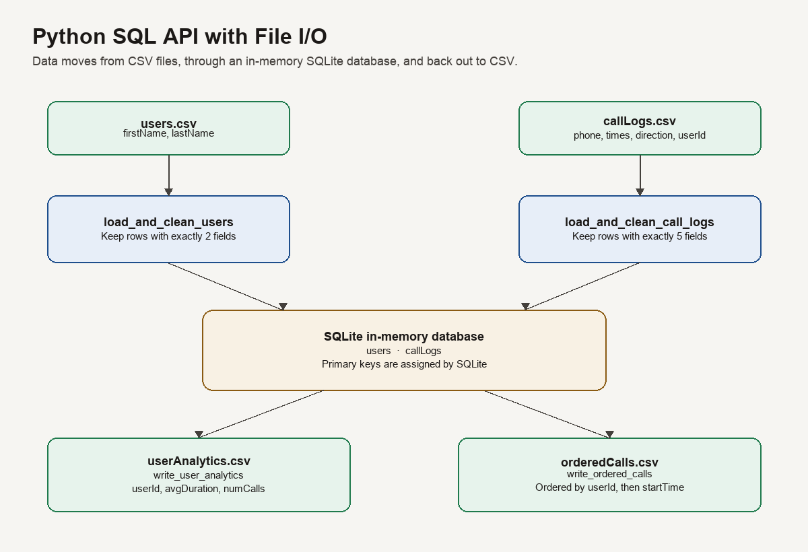
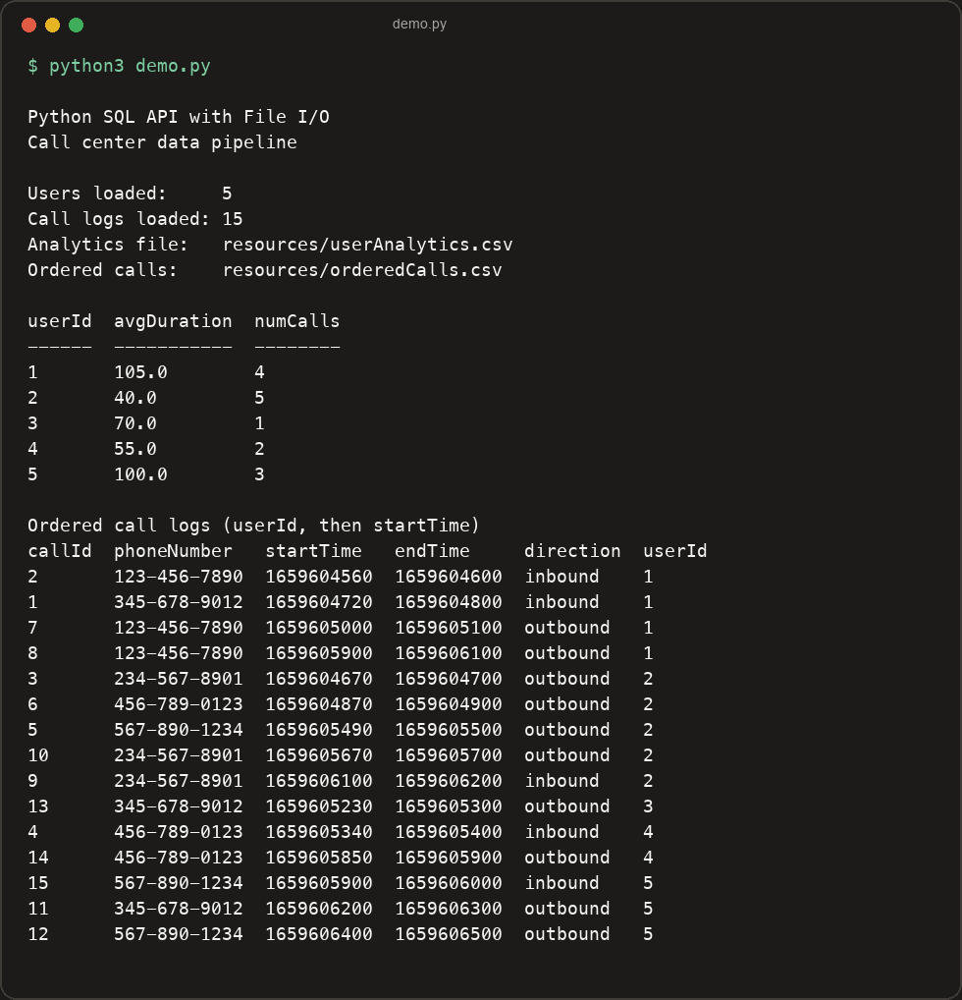

# Python SQL API with File I/O

**GitHub repository:** [https://github.com/NappyyCoder/Python-SQL-API-with-File-IO](https://github.com/NappyyCoder/Python-SQL-API-with-File-IO)

**Architecture wiki:** [https://github.com/NappyyCoder/Python-SQL-API-with-File-IO/wiki](https://github.com/NappyyCoder/Python-SQL-API-with-File-IO/wiki)

## Project Description

This is a Python backend for a hypothetical call center. It manages two kinds of records: the people who handle calls, and the calls themselves. The program reads those records from CSV files, skips rows that are incomplete or have the wrong number of fields, and stores the clean rows in an in-memory SQLite database.

From that database it writes two results back to CSV:

- `userAnalytics.csv` — average call duration and number of calls for each user
- `orderedCalls.csv` — every stored call, sorted by user and then by start time

There is no website or desktop window. You run it from the terminal. The graded entry points live in `src/main/main.py`. `demo.py` creates the database tables and runs the full pipeline on the sample files in `resources/`.

The project architecture, including the data flow, table schema, and cleaning rules, is written up in [docs/wiki/Architecture.md](docs/wiki/Architecture.md) and published on the [project wiki](https://github.com/NappyyCoder/Python-SQL-API-with-File-IO/wiki/Architecture).

## Technologies Used

- Python - 3.13.1 (3.10 or newer is enough)
- SQLite - 3.45.3, through Python's `sqlite3` module, stored in memory
- Python `csv` - standard library, same release as the Python install
- Python `unittest` - standard library, same release as the Python install

No third-party packages are required. `pip install` is not part of setup. These commands are for a local machine. They are not tied to AWS, GCP, or any other cloud platform, and they work on macOS, Linux, and Windows.

## Features

- Load `resources/users.csv` into the `users` table
- Load `resources/callLogs.csv` into the `callLogs` table
- Skip any row that has an empty field or the wrong number of fields
- Let SQLite assign `userId` and `callId`
- Compute average call duration and call count per user
- Write `resources/userAnalytics.csv`
- Write `resources/orderedCalls.csv`, ordered by `userId` and then `startTime`
- Unit tests for cleaning, analytics, and sort order

### To-do list

- Save the database to a file so the data is still there after the program exits
- Add command-line arguments for choosing input and output paths
- Check that phone numbers, timestamps, and call direction are valid values
- Format average duration to a fixed number of decimal places when a report needs it

## Getting Started

Install Git and Python 3.10 or newer. Then clone the repository and run the demo. Nothing else needs to be installed.

The diagram below is the shape of a successful run: two input files go into SQLite, and two result files come back out.



### Unix (macOS and Linux)

```bash
git clone https://github.com/NappyyCoder/Python-SQL-API-with-File-IO.git
cd Python-SQL-API-with-File-IO
python3 --version
python3 demo.py
python3 -m unittest src.test.lab_test -v
```

### Windows (Command Prompt or PowerShell)

```bat
git clone https://github.com/NappyyCoder/Python-SQL-API-with-File-IO.git
cd Python-SQL-API-with-File-IO
py -3 --version
py -3 demo.py
py -3 -m unittest src.test.lab_test -v
```

On Windows, if `py` is not recognized, use `python` in place of `py -3`. On macOS or Linux, use `python3`, not `python`, when both Python 2 and Python 3 are installed.

`demo.py` reads the CSV files that ship in `resources/`, creates the tables, and overwrites these two result files:

- `resources/userAnalytics.csv`
- `resources/orderedCalls.csv`

The four tests in `src/test/lab_test.py` use the smaller CSV files in `src/test/`. They should finish with `OK`.

`src/main/main.py` does not create tables or load files when you run it directly. The test runner does that setup itself and then calls `load_and_clean_users`, `load_and_clean_call_logs`, `write_user_analytics`, and `write_ordered_calls`. Use `demo.py` when you want to see the pipeline run.

## Usage

After the project is cloned, run the demo from the project folder.

Unix:

```bash
python3 demo.py
```

Windows:

```bat
py -3 demo.py
```

A run against the included sample data loads 5 users and 15 call logs. Rows in the source CSV files that are missing a value, or that have extra columns, are left out. The terminal prints the analytics and the ordered calls. It should look like this:



`resources/userAnalytics.csv` from that run:

```csv
userId,avgDuration,numCalls
1,105.0,4
2,40.0,5
3,70.0,1
4,55.0,2
5,100.0,3
```

`avgDuration` is the average of `endTime - startTime` for that user's calls. `numCalls` is how many of that user's calls were stored. Duration is in the same units as the timestamps in the source file (seconds).

`resources/orderedCalls.csv` has one row per stored call, with this header:

```csv
callId,phoneNumber,startTime,endTime,direction,userId
```

Rows are sorted by `userId` ascending, and within each user by `startTime` ascending.

To run only the tests:

Unix:

```bash
python3 -m unittest src.test.lab_test -v
```

Windows:

```bat
py -3 -m unittest src.test.lab_test -v
```

The tests check four things: user rows are cleaned before insert, call rows are cleaned before insert, analytics match the test data, and ordered calls are sorted by user and start time.

## Contributors

This is a solo project.

- [NappyyCoder](https://github.com/NappyyCoder)

## License

This project uses the following license: MIT.

See the [LICENSE](LICENSE) file for the full text.
