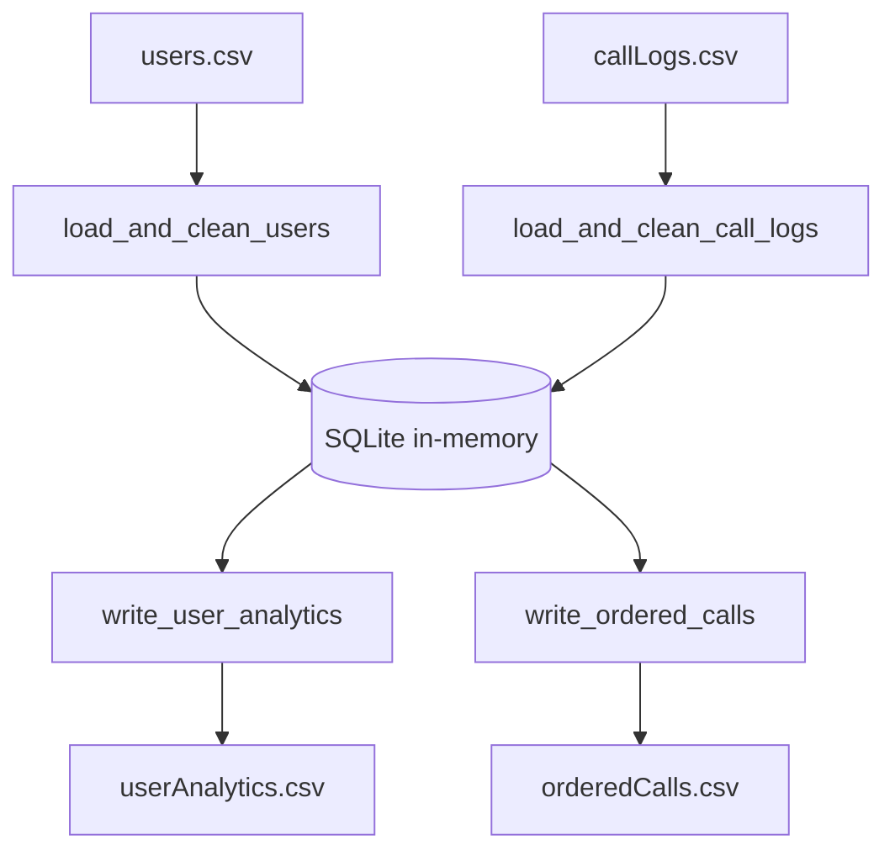

# Architecture

This application is one Python process. It does not start a web server, and it does not keep a database file on disk. When `src/main/main.py` is imported, it opens a single SQLite connection with `sqlite3.connect(':memory:')`. That database disappears when the process exits. The CSV files in `resources/` are the inputs and the saved outputs.

## Layout

```text
demo.py                     Local runner. Creates tables and runs the pipeline.
src/main/main.py            Database connection and the four pipeline functions.
src/test/lab_test.py        Unit tests. Creates tables in setUp.
resources/users.csv         Input. firstName, lastName.
resources/callLogs.csv      Input. phoneNumber, startTime, endTime, direction, userId.
resources/userAnalytics.csv Output. userId, avgDuration, numCalls.
resources/orderedCalls.csv  Output. call logs ordered by userId, then startTime.
```

## Data flow



1. `demo.py` or the test `setUp` creates `users` and `callLogs`.
2. `load_and_clean_users` reads a user CSV and inserts clean rows.
3. `load_and_clean_call_logs` reads a call CSV and inserts clean rows.
4. `write_user_analytics` queries `callLogs` and writes one summary row per user.
5. `write_ordered_calls` queries `callLogs` with `ORDER BY userId, startTime` and writes every stored call.

`main()` in `src/main/main.py` is intentionally empty. The graded test runner creates the tables, calls the four functions, and owns the database connection. `demo.py` is the local path that does that setup for you.

## Tables

Both id columns are `INTEGER PRIMARY KEY`, so SQLite assigns the next id on insert. The loaders do not write `userId` or `callId`.

### users

| Column | Type | Notes |
| --- | --- | --- |
| userId | INTEGER PRIMARY KEY | Assigned by SQLite |
| firstName | TEXT | From the CSV |
| lastName | TEXT | From the CSV |

### callLogs

| Column | Type | Notes |
| --- | --- | --- |
| callId | INTEGER PRIMARY KEY | Assigned by SQLite |
| phoneNumber | TEXT | From the CSV |
| startTime | INTEGER | Unix time in seconds |
| endTime | INTEGER | Unix time in seconds |
| direction | TEXT | `inbound` or `outbound` in the sample data |
| userId | INTEGER | Foreign key to `users.userId` |

The foreign key is declared on `callLogs`. The loaders do not reject a call whose `userId` is missing from `users`. They only reject a call row that is malformed.

## Cleaning rules

A row is inserted only when every field is present and the column count matches the file.

| File | Required fields, excluding the id | Reject when |
| --- | --- | --- |
| users | `firstName`, `lastName` | Not exactly 2 fields, or any field is blank after trimming spaces |
| call logs | `phoneNumber`, `startTime`, `endTime`, `direction`, `userId` | Not exactly 5 fields, or any field is blank after trimming spaces |

The header row is always skipped. Call times and `userId` are stored as integers. User names and the phone number are stored as text. Queries use parameter placeholders (`?`) rather than building SQL from the CSV text.

## Analytics and ordering

`write_user_analytics` reads `userId`, `startTime`, and `endTime` from `callLogs`. Duration for one call is `endTime - startTime`. For each user the function keeps a list of durations and a call count, then writes:

```text
userId,avgDuration,numCalls
```

`avgDuration` is the arithmetic mean. It is not rounded. Rows are written in ascending `userId` order.

`write_ordered_calls` does the sort in SQL:

```sql
SELECT callId, phoneNumber, startTime, endTime, direction, userId
FROM callLogs
ORDER BY userId, startTime
```

## Tests

`src/test/lab_test.py` uses `unittest`. Each test drops and recreates both tables, then calls the pipeline functions with the CSV files in `src/test/`. Those files are separate from `resources/`, so the sample data and the test data can differ.

| Test | What it checks |
| --- | --- |
| `test_users_table_has_clean_data` | Incomplete user rows are not inserted |
| `test_calllogs_table_has_clean_data` | Incomplete call rows are not inserted |
| `test_user_analytics_are_correct` | Average duration and call counts match the test file |
| `test_call_logs_are_ordered` | Output is ordered by user, then by start time |

## Design notes

- One shared cursor in `src/main/main.py` is what the tests and `demo.py` both use. Do not open a second connection inside the loaders.
- The database is in memory so each test starts clean and a demo run does not leave a `.db` file behind.
- Result files are plain CSV so they can be opened in a spreadsheet or diffed in git.
